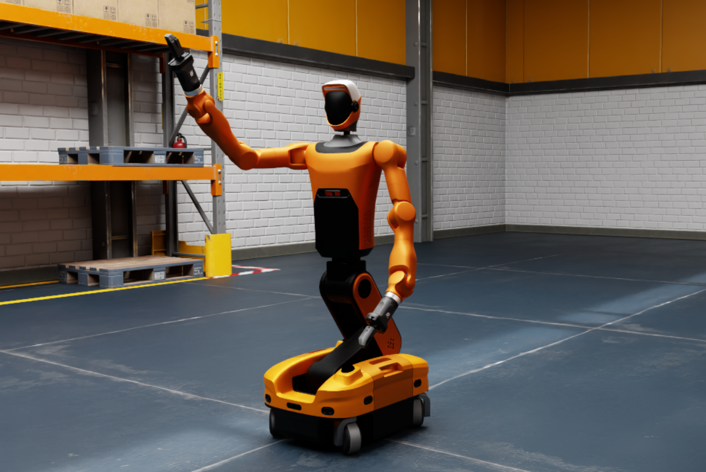

# FiveAges W2 Description

This package contains the description files for FiveAges W2 humanoid.



## 1. Build

```bash
cd ~/ros2_ws
colcon build --packages-up-to fiveages_w2_description --symlink-install
```

## 2. Visualize the robot

### 2.1 Full Robot
* FiveAges W2 (Basic visualization)
  ```bash
  source ~/ros2_ws/install/setup.bash
  ros2 launch robot_common_launch humanoid.launch.py robot:=fiveages_w2 collider:=simple
  ```

### 2.2 Component
* Linkhou S2 Base
  ```bash
  source ~/ros2_ws/install/setup.bash
  ros2 launch robot_common_launch component.launch.py robot:=fiveages_w2
  ```
* Body
  ```bash
  source ~/ros2_ws/install/setup.bash
  ros2 launch robot_common_launch component.launch.py robot:=fiveages_w2 type:=body
  ```

### 3.2 OCS2 Arm Controller Demo

#### 3.2.1 Mock Component

* Empty Hand (Full Body Control)
  ```bash
  source ~/ros2_ws/install/setup.bash
  ros2 launch ocs2_arm_controller full_body.launch.py robot:=fiveages_w2
  ```
* Empty Hand (Split Body Control)
  ```bash
  source ~/ros2_ws/install/setup.bash
  ros2 launch ocs2_arm_controller split_body.launch.py robot:=fiveages_w2
  ```
* Only Body
  ```bash
  source ~/ros2_ws/install/setup.bash
  ros2 launch basic_joint_controller demo.launch.py robot:=fiveages_w2
  ```

#### 3.2.2 Isaac Sim
* Empty Hand (Full Body Control)
  ```bash
  source ~/ros2_ws/install/setup.bash
  ros2 launch ocs2_arm_controller full_body.launch.py robot:=fiveages_w2 hardware:=isaac
  ```
  
## 4. Real Robot Deploy
* Only Body
  ```bash
  source ~/ros2_ws/install/setup.bash
  ros2 launch basic_joint_controller demo.launch.py robot:=fiveages_w2 hardware:=real enable_head:=false
  ```